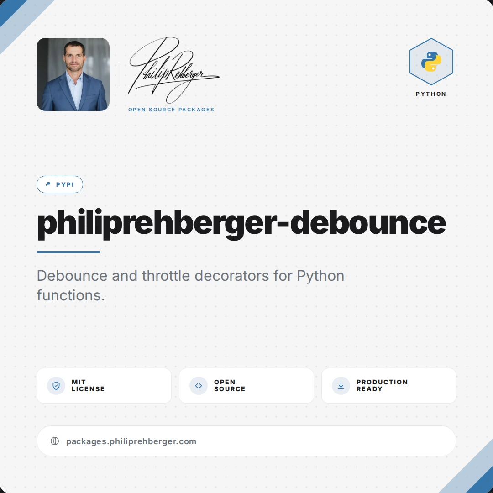

# philiprehberger-debounce

[](https://github.com/philiprehberger/py-debounce/actions/workflows/publish.yml)
[](https://pypi.org/project/philiprehberger-debounce/)
[](https://github.com/philiprehberger/py-debounce/commits/main)



Debounce and throttle decorators for Python functions.

## Installation

```bash
pip install philiprehberger-debounce
```

## Usage

```python
from philiprehberger_debounce import debounce, throttle
```

### Debounce

Delay execution until a quiet period has passed. Each new call resets the timer.

```python
@debounce(0.5)
def on_resize(width, height):
    print(f"Resized to {width}x{height}")

on_resize(800, 600)
on_resize(1024, 768)  # cancels the previous call
# Only the last call executes after 0.5s
```

### Bounded debounce

Use `max_wait` to guarantee the function fires at most `max_wait` seconds after the *first* pending call, even if calls keep arriving and continuously reset the debounce timer. Mirrors lodash `debounce({ maxWait })` semantics.

```python
@debounce(0.5, max_wait=2.0)
def autosave(content):
    print(f"Saving: {content[:20]}...")

# Even with continuous edits, autosave fires at least every 2s.
for chunk in stream_keystrokes():
    autosave(chunk)
```

`max_wait` must be positive and `>= seconds`; otherwise `ValueError` is raised.

### Cancel and flush

The wrapper exposes `.cancel()` (drop any pending trailing call) and `.flush()` (fire it immediately). Mirrors the lodash debounce control API.

```python
@debounce(0.5)
def save(content):
    print(f"saving {content}")

save("draft 1")
save.cancel()       # drop the pending call
save("draft 2")
save.flush()        # fire immediately, don't wait for the timer
```

### Pending check

`.is_pending()` returns whether a trailing call is queued — useful for showing "Saving…" indicators or guarding code paths that depend on whether the debounced action will still fire.

```python
@debounce(0.5)
def save(content):
    ...

save("draft 1")
if save.is_pending():
    show("Saving…")
```

### Throttle

Limit a function to a fixed number of calls within a time window. Excess calls are silently dropped.

```python
@throttle(calls=3, per=1.0)
def send_request(data):
    print(f"Sending {data}")

for i in range(10):
    send_request(i)  # only the first 3 calls within 1s execute
```

### Throttle helpers

The throttle wrapper exposes `.remaining()` (calls still allowed in the current window) and `.reset()` (clear the window so the full quota is available again). Both are thread-safe.

```python
@throttle(calls=5, per=60.0)
def call_api(payload):
    ...

call_api({"id": 1})
print(call_api.remaining())  # 4
call_api.reset()             # e.g. after the upstream quota is refreshed
print(call_api.remaining())  # 5
```

### Async functions

Both decorators accept `async def` functions.

A debounced coroutine function is wrapped in a regular (non-async) function that returns `None` — do not `await` it. Call it from inside a running event loop; the trailing call is scheduled with `loop.call_later` and runs as an `asyncio.Task` on that loop. `leading`, `max_wait`, `.cancel()`, and `.is_pending()` work as they do for sync functions, and `.flush()` returns the started `asyncio.Task` (or `None` if nothing was pending) so you can await it.

```python
import asyncio

@debounce(0.3)
async def search(query):
    return await fetch_results(query)

async def main():
    search("p")
    search("py")
    search("pyt")          # only this call runs, 0.3s later
    task = search.flush()  # or start it right away
    if task is not None:
        results = await task

asyncio.run(main())
```

A throttled coroutine function stays a coroutine function: awaiting an allowed call returns the result, and awaiting a dropped call returns `None` without running the function.

```python
@throttle(calls=2, per=1.0)
async def ping(host):
    return await probe(host)

async def main():
    print(await ping("a"))  # result
    print(await ping("b"))  # result
    print(await ping("c"))  # None — dropped

asyncio.run(main())
```

## API

| Function / Class | Description |
|------------------|-------------|
| `debounce(seconds, *, leading=False, max_wait=None)` | Decorator that delays a call until `seconds` of quiet have passed; each new call restarts the timer. `leading=True` fires on the leading edge and suppresses calls until `seconds` of silence. `max_wait` (positive, `>= seconds`) bounds how long a call may be deferred from the first pending call. Works on sync and `async def` functions; the wrapper returns `None` |
| `wrapper.cancel()` | Discard any pending trailing call and reset leading-edge state |
| `wrapper.flush()` | Fire the pending trailing call immediately (no-op if none); for coroutine functions returns the started `asyncio.Task` or `None` |
| `wrapper.is_pending()` | Return `True` if a trailing call is queued and not yet fired |
| `throttle(calls, per)` | Decorator that allows at most `calls` invocations per sliding window of `per` seconds; extra calls are dropped and return `None`. Works on sync and `async def` functions |
| `wrapper.remaining()` | Return how many calls are still allowed in the current throttle window |
| `wrapper.reset()` | Clear the throttle window so the full quota is available again |

## Development

```bash
pip install -e .
python -m pytest tests/ -v
```

## Support

If you find this project useful:

⭐ [Star the repo](https://github.com/philiprehberger/py-debounce)

🐛 [Report issues](https://github.com/philiprehberger/py-debounce/issues?q=is%3Aissue+is%3Aopen+label%3Abug)

💡 [Suggest features](https://github.com/philiprehberger/py-debounce/issues?q=is%3Aissue+is%3Aopen+label%3Aenhancement)

❤️ [Sponsor development](https://github.com/sponsors/philiprehberger)

🌐 [All Open Source Projects](https://philiprehberger.com/open-source-packages)

💻 [GitHub Profile](https://github.com/philiprehberger)

🔗 [LinkedIn Profile](https://www.linkedin.com/in/philiprehberger)

## License

[MIT](LICENSE)
